  <a href="./README.md">PT-BR</a> · <strong>EN</strong>

<picture>
  <source media="(prefers-color-scheme: dark)" srcset="./assets/header-en-dark.svg" />
  <source media="(prefers-color-scheme: light)" srcset="./assets/header-en-light.svg" />
  
</picture>

 

  Developer continuously growing in the <strong>Full-Stack Web</strong> ecosystem. I have a strong foundation in <strong>JavaScript, Node.js, HTML5, and CSS</strong>, I am advancing my skills in <strong>React</strong>, I have built practical backend foundations in <strong>Java</strong>, and I am currently studying <strong>Agentic AI</strong> to build intelligent workflows and real-world applications.

  
  
  <!-- Once your portfolio site is live, wrap this badge in <a href="https://your-site.dev">...</a> and update the text to "Live" -->
  

 

<picture>
  <source media="(prefers-color-scheme: dark)" srcset="./assets/divider-dark.svg" />
  <source media="(prefers-color-scheme: light)" srcset="./assets/divider-light.svg" />
  
</picture>

## Learning Journey

<picture>
  <source media="(prefers-color-scheme: dark)" srcset="./assets/journey-en-dark.svg" />
  <source media="(prefers-color-scheme: light)" srcset="./assets/journey-en-light.svg" />
  
</picture>

  <strong>Current focus:</strong> combining my JavaScript and Node.js foundation with modern <strong>React</strong> interfaces, exploring <strong>autonomous agent patterns and Tool Use</strong> in Agentic AI, and building my upcoming <strong>personal portfolio website</strong>.

 

<picture>
  <source media="(prefers-color-scheme: dark)" srcset="./assets/divider-dark.svg" />
  <source media="(prefers-color-scheme: light)" srcset="./assets/divider-light.svg" />
  
</picture>

## Featured Projects

<!--
  Customization tip:
  1. The cards below were written from each repository's README and source code.
  2. To display animated GIF previews, save them under ./assets/previews/ and uncomment the  line in each card.
-->

<table width="100%">
  <tr>
    <td width="50%" valign="top">
      <h3><a href="https://github.com/P3dro236/ChatBot-Tarefas">ChatBot-Tarefas</a></h3>
      <!-- 

 -->
      
WhatsApp study assistant that understands natural-language messages with <strong>Google Gemini</strong>, extracts assignment details, and stores each user's tasks in PostgreSQL.

      
<strong>Highlights:</strong> conversation memory to ask for missing details, automatic model fallback, Zod-validated Express API, and <code>node --test</code> test suite.

      
<code>Node.js</code> <code>Gemini API</code> <code>PostgreSQL</code> <code>Express</code> <code>Zod</code>

      
<a href="https://github.com/P3dro236/ChatBot-Tarefas">View repository →</a>

    </td>
    <td width="50%" valign="top">
      <h3><a href="https://github.com/P3dro236/MG300-WEBAPP">MG300 Web Controller</a></h3>
      <!-- 

 -->
      
Full-stack web controller for the <strong>NUX MG-300</strong> pedalboard, connected to a computer via USB. Edit tones in the browser and control the unit from a phone on the same Wi-Fi network using QR Code pairing.

      
<strong>Highlights:</strong> 10-block editor and preset management, real-time WebSocket sync, and mobile access with explicit approval.

      
<code>TypeScript</code> <code>React</code> <code>Node.js</code> <code>Fastify</code> <code>USB-MIDI</code>

      
<a href="https://github.com/P3dro236/MG300-WEBAPP">View repository →</a>

    </td>
  </tr>
  <tr>
    <td width="50%" valign="top">
      <h3><a href="https://github.com/Ovini8894/AstroLab">AstroLab</a></h3>
      <!-- 

 -->
      
Team-built 3D <strong>Unity</strong> game where the player restores an abandoned lunar base through missions that manage oxygen, battery, and spare parts.

      
<strong>My part:</strong> mission rules and economy, save/load during EVA, victory checklist, repair effects, world markers, and EditMode tests for the core.

      
<code>C#</code> <code>Unity</code> <code>URP</code> <code>Teamwork</code>

      
<a href="https://github.com/Ovini8894/AstroLab">View repository →</a>

    </td>
    <td width="50%" valign="top">
      <h3><a href="https://github.com/P3dro236/simpleCRUD">simpleCRUD</a></h3>
      <!-- 

 -->
      
Simple REST API in <strong>Java</strong> with Spring Boot to create, list, update, and delete users, persisting data in PostgreSQL.

      
<strong>Key takeaway:</strong> layered architecture (controller, service, repository), Spring Data JPA, and first steps in the Java ecosystem.

      
<code>Java</code> <code>Spring Boot</code> <code>JPA</code> <code>PostgreSQL</code>

      
<a href="https://github.com/P3dro236/simpleCRUD">View repository →</a>

    </td>
  </tr>
</table>

  <strong>Up next · Personal Website &amp; Portfolio (in planning):</strong> a dedicated space to showcase my learning journey, interactive React projects, and upcoming Agentic AI experiments on a custom domain.

 

<picture>
  <source media="(prefers-color-scheme: dark)" srcset="./assets/divider-dark.svg" />
  <source media="(prefers-color-scheme: light)" srcset="./assets/divider-light.svg" />
  
</picture>

## Tech Stack

  <strong>Core Web &amp; Backend</strong> 
  
  
  
  
  
  

  <strong>Evolving &amp; Cross-Stack</strong> 
  
  
  
  
  

  <strong>Exploring &amp; Tools</strong> 
  
  
  
  

 

<picture>
  <source media="(prefers-color-scheme: dark)" srcset="./assets/divider-dark.svg" />
  <source media="(prefers-color-scheme: light)" srcset="./assets/divider-light.svg" />
  
</picture>

## GitHub Activity

<table width="100%">
  <tr>
    <td width="46%" align="center" valign="middle">
      <picture>
        <source media="(prefers-color-scheme: dark)" srcset="https://github-readme-stats.vercel.app/api/top-langs/?username=P3dro236&amp;layout=compact&amp;langs_count=6&amp;hide_border=false&amp;border_radius=10&amp;locale=en&amp;bg_color=0d1117&amp;border_color=21262d&amp;title_color=818cf8&amp;icon_color=6366f1&amp;text_color=c9d1d9&amp;ring_color=6366f1" />
        <source media="(prefers-color-scheme: light)" srcset="https://github-readme-stats.vercel.app/api/top-langs/?username=P3dro236&amp;layout=compact&amp;langs_count=6&amp;hide_border=false&amp;border_radius=10&amp;locale=en&amp;bg_color=ffffff&amp;border_color=e2e8f0&amp;title_color=4f46e5&amp;icon_color=4f46e5&amp;text_color=334155&amp;ring_color=4f46e5" />
        
      </picture>
    </td>
    <td width="54%" align="center" valign="middle">
      <picture>
        <source media="(prefers-color-scheme: dark)" srcset="https://streak-stats.demolab.com?user=P3dro236&amp;border_radius=10&amp;locale=en&amp;background=0D1117&amp;border=21262D&amp;stroke=21262D&amp;ring=6366F1&amp;fire=818CF8&amp;currStreakNum=F0F6FC&amp;sideNums=F0F6FC&amp;currStreakLabel=818CF8&amp;sideLabels=8B949E&amp;dates=6E7681" />
        <source media="(prefers-color-scheme: light)" srcset="https://streak-stats.demolab.com?user=P3dro236&amp;border_radius=10&amp;locale=en&amp;background=FFFFFF&amp;border=E2E8F0&amp;stroke=E2E8F0&amp;ring=4F46E5&amp;fire=4F46E5&amp;currStreakNum=0F172A&amp;sideNums=0F172A&amp;currStreakLabel=4F46E5&amp;sideLabels=475569&amp;dates=64748B" />
        
      </picture>
    </td>
  </tr>
</table>

 

  Pedro Henrique Gonçalves · Continuous learning, one commit at a time.

