  <strong>PT-BR</strong> · <a href="./README.en.md">EN</a>

<picture>
  <source media="(prefers-color-scheme: dark)" srcset="./assets/header-pt-dark.svg" />
  <source media="(prefers-color-scheme: light)" srcset="./assets/header-pt-light.svg" />
  
</picture>

 

  Desenvolvedor em evolução contínua no ecossistema <strong>Full-Stack Web</strong>. Tenho base sólida em <strong>JavaScript, Node.js, HTML5 e CSS</strong>, venho aprofundando meus projetos em <strong>React</strong>, já explorei desenvolvimento backend com <strong>Java</strong> e atualmente estudo <strong>IA Agêntica</strong> para construir fluxos inteligentes e aplicações práticas.

  
  
  <!-- Quando publicar seu site portfólio, envolva esta imagem com <a href="https://seu-site.dev">...</a> e atualize o texto para "Online" -->
  

 

<picture>
  <source media="(prefers-color-scheme: dark)" srcset="./assets/divider-dark.svg" />
  <source media="(prefers-color-scheme: light)" srcset="./assets/divider-light.svg" />
  
</picture>

## Jornada de Estudos

<picture>
  <source media="(prefers-color-scheme: dark)" srcset="./assets/journey-pt-dark.svg" />
  <source media="(prefers-color-scheme: light)" srcset="./assets/journey-pt-light.svg" />
  
</picture>

  <strong>Foco atual:</strong> unir minha base em JavaScript e Node.js ao desenvolvimento de interfaces em <strong>React</strong>, explorar padrões de <strong>agentes autônomos e uso de ferramentas (Tool Use)</strong> em IA Agêntica e tirar do papel meu primeiro <strong>site portfólio pessoal</strong>.

 

<picture>
  <source media="(prefers-color-scheme: dark)" srcset="./assets/divider-dark.svg" />
  <source media="(prefers-color-scheme: light)" srcset="./assets/divider-light.svg" />
  
</picture>

## Projetos em Destaque

<!--
  Dica de personalização:
  1. Os cards abaixo foram escritos a partir dos READMEs e do código de cada repositório.
  2. Para adicionar previews animados (GIFs), salve os arquivos em ./assets/previews/ e descomente o bloco  de cada card.
-->

<table width="100%">
  <tr>
    <td width="50%" valign="top">
      <h3><a href="https://github.com/P3dro236/ChatBot-Tarefas">ChatBot-Tarefas</a></h3>
      <!-- 

 -->
      
Assistente acadêmico para WhatsApp que entende mensagens em linguagem natural com o <strong>Google Gemini</strong>, extrai dados das atividades e salva as tarefas de cada usuário no PostgreSQL.

      
<strong>Destaques:</strong> memória de conversa para pedir dados faltantes, fallback automático entre modelos, API Express validada com Zod e testes com <code>node --test</code>.

      
<code>Node.js</code> <code>Gemini API</code> <code>PostgreSQL</code> <code>Express</code> <code>Zod</code>

      
<a href="https://github.com/P3dro236/ChatBot-Tarefas">Ver repositório →</a>

    </td>
    <td width="50%" valign="top">
      <h3><a href="https://github.com/P3dro236/NanoBox">NanoBox</a></h3>
      <!-- 

 -->
      
Landing page de uma nuvem pessoal em hardware local (modelo HaaS), feita como projeto acadêmico do curso de ADS da Uniube.

      
<strong>Destaques:</strong> Atomic Design, dark mode com glassmorphism, animações de scroll com Framer Motion e FAQ interativo.

      
<code>React</code> <code>Vite</code> <code>Tailwind CSS</code> <code>Framer Motion</code>

      
<a href="https://nano-box.vercel.app">Ver demo</a> · <a href="https://github.com/P3dro236/NanoBox">Ver repositório →</a>

    </td>
  </tr>
  <tr>
    <td width="50%" valign="top">
      <h3><a href="https://github.com/Ovini8894/AstroLab">AstroLab</a></h3>
      <!-- 

 -->
      
Jogo 3D em <strong>Unity</strong> desenvolvido em equipe: o jogador restaura uma base lunar abandonada em missões com gestão de oxigênio, bateria e peças.

      
<strong>Minha parte:</strong> regras e economia da missão, save/load durante a EVA, checklist de vitória, efeitos de reparo, marcadores no mundo e testes EditMode do núcleo.

      
<code>C#</code> <code>Unity</code> <code>URP</code> <code>Trabalho em equipe</code>

      
<a href="https://github.com/Ovini8894/AstroLab">Ver repositório →</a>

    </td>
    <td width="50%" valign="top">
      <h3><a href="https://github.com/P3dro236/simpleCRUD">simpleCRUD</a></h3>
      <!-- 

 -->
      
API REST simples em <strong>Java</strong> com Spring Boot para cadastrar, listar, atualizar e remover usuários, persistindo os dados no PostgreSQL.

      
<strong>Aprendizado:</strong> arquitetura em camadas (controller, service, repository), Spring Data JPA e primeiros passos no ecossistema Java.

      
<code>Java</code> <code>Spring Boot</code> <code>JPA</code> <code>PostgreSQL</code>

      
<a href="https://github.com/P3dro236/simpleCRUD">Ver repositório →</a>

    </td>
  </tr>
</table>

  <strong>Próximo projeto · Site &amp; Portfólio Pessoal (em planejamento):</strong> espaço dedicado para reunir minha trajetória de estudos, projetos interativos em React e futuros experimentos em IA Agêntica em um domínio próprio.

 

<picture>
  <source media="(prefers-color-scheme: dark)" srcset="./assets/divider-dark.svg" />
  <source media="(prefers-color-scheme: light)" srcset="./assets/divider-light.svg" />
  
</picture>

## Tech Stack

  <strong>Core Web &amp; Backend</strong> 
  
  
  
  
  
  

  <strong>Em Evolução &amp; Multi-Stack</strong> 
  
  
  
  
  

  <strong>Explorando &amp; Ferramentas</strong> 
  
  
  
  

 

<picture>
  <source media="(prefers-color-scheme: dark)" srcset="./assets/divider-dark.svg" />
  <source media="(prefers-color-scheme: light)" srcset="./assets/divider-light.svg" />
  
</picture>

## Atividade no GitHub

<table width="100%">
  <tr>
    <td width="46%" align="center" valign="middle">
      <picture>
        <source media="(prefers-color-scheme: dark)" srcset="https://github-readme-stats.vercel.app/api/top-langs/?username=P3dro236&amp;layout=compact&amp;langs_count=6&amp;hide_border=false&amp;border_radius=10&amp;locale=pt-br&amp;bg_color=0d1117&amp;border_color=21262d&amp;title_color=818cf8&amp;icon_color=6366f1&amp;text_color=c9d1d9&amp;ring_color=6366f1" />
        <source media="(prefers-color-scheme: light)" srcset="https://github-readme-stats.vercel.app/api/top-langs/?username=P3dro236&amp;layout=compact&amp;langs_count=6&amp;hide_border=false&amp;border_radius=10&amp;locale=pt-br&amp;bg_color=ffffff&amp;border_color=e2e8f0&amp;title_color=4f46e5&amp;icon_color=4f46e5&amp;text_color=334155&amp;ring_color=4f46e5" />
        
      </picture>
    </td>
    <td width="54%" align="center" valign="middle">
      <picture>
        <source media="(prefers-color-scheme: dark)" srcset="https://streak-stats.demolab.com?user=P3dro236&amp;border_radius=10&amp;locale=pt-br&amp;background=0D1117&amp;border=21262D&amp;stroke=21262D&amp;ring=6366F1&amp;fire=818CF8&amp;currStreakNum=F0F6FC&amp;sideNums=F0F6FC&amp;currStreakLabel=818CF8&amp;sideLabels=8B949E&amp;dates=6E7681" />
        <source media="(prefers-color-scheme: light)" srcset="https://streak-stats.demolab.com?user=P3dro236&amp;border_radius=10&amp;locale=pt-br&amp;background=FFFFFF&amp;border=E2E8F0&amp;stroke=E2E8F0&amp;ring=4F46E5&amp;fire=4F46E5&amp;currStreakNum=0F172A&amp;sideNums=0F172A&amp;currStreakLabel=4F46E5&amp;sideLabels=475569&amp;dates=64748B" />
        
      </picture>
    </td>
  </tr>
</table>

 

  Pedro Henrique Gonçalves · Aprendizado contínuo, um commit por vez.

